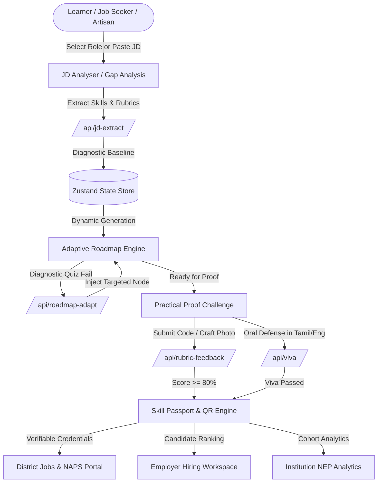

# SkillBridge AI • திறன் பாலம்
> **The AI Skill-to-Opportunity Engine for Tamil Nadu**  
> *"கற்றனைத் தூறும் அறிவு — Learn a skill. Prove your ability. Unlock your next opportunity."*

[](#)
[](#)
[](#)
[](#)
[](#)
[](#)
[](#)

---

## 🏛️ Executive Summary

**SkillBridge AI (திறன் பாலம்)** is a civic skill-to-opportunity engine designed specifically for learners, job-seekers, artisans, and vocational practitioners across Tamil Nadu. Unlike traditional e-learning platforms that award paper certificates for passive video watching, SkillBridge focuses on **evidence-based mastery**:

1. **Zero-Fluff Gap Analysis**: Parses real job descriptions (JDs) using AI to isolate exact rubric criteria.
2. **Adaptive Daily Roadmaps**: Dynamically adjusts curriculum based on diagnostic scores and daily time commitments (30–90 mins).
3. **Multi-Modal Proof**: Accepts live GitHub code, photo inspections for physical crafts (e.g. 10 stitches-per-inch blouse seam margins with measuring tape/coin scale), and spoken voice vivas.
4. **Bilingual by Design**: Fluent support for English, Tamil (தமிழ்), and Thanglish, eliminating linguistic barriers for rural youth.
5. **Verifiable Skill Passport**: Cryptographically signed digital credential with tamper-evident QR code for instant employer verification.

---

## 📐 System Architecture

### High-Level Architectural Flow



### Component & Routing Architecture

SkillBridge uses **code-split route lazy loading** via `React.lazy()` and `Suspense`, reducing the initial client payload from **2.48 MB** down to **363 kB**.

```
src/
├── App.tsx                     # Lazy router, Suspense fallback, ErrorBoundary, 404 sync
├── main.tsx                    # React 19 root mount, i18n initialization
├── index.css                   # Design tokens, Noto Sans Tamil typography, print media rules
├── components/
│   ├── AppLayout.tsx           # Accessible layout with skip links, desktop sidebar, mobile nav
│   ├── GlassNavbar.tsx         # Sticky frosted header, live status ticker, persona switcher
│   ├── Skeleton.tsx            # Shimmer skeleton loaders (cards, text, grids)
│   ├── ViewSkeleton.tsx        # Route-level suspense skeleton with bilingual status
│   ├── EmptyState.tsx          # Reusable zero-data state with Tamil titles and action handlers
│   ├── ErrorBoundary.tsx       # Class error boundary with recoverable retry options
│   ├── JdAnalyserModal.tsx     # Live JD parsing dialog with Claude mock integration
│   ├── CssQuizModal.tsx        # Interactive 3-question Flexbox layout test
│   ├── QuickVivaModal.tsx      # Oral defense modal with mic recording and feedback
│   └── GuidedDemoModal.tsx     # 11-step interactive tour (Shift+D)
├── views/                      # 16 Code-split views:
│   ├── HomeView.tsx            # Hero, Avvaiyar proverbs, interactive map, 5-step loop
│   ├── GapAnalysisView.tsx     # In-depth skill delta visualizer
│   ├── RoadmapView.tsx         # Milestone graph, lesson drawer, audio briefs
│   ├── ChallengesView.tsx      # Code sandbox, tailoring photo upload, rubric grading
│   ├── PassportView.tsx        # Cryptographic passport, dynamic QR, tamper seal
│   ├── ResumeView.tsx          # 1-Page printable A4 resume with PDF export
│   ├── InterviewView.tsx       # AI mock interview with speech pacing and filler detection
│   ├── CoachView.tsx           # Bilingual Tamil voice mentor
│   ├── EmployerView.tsx        # Hiring pipeline ranked by rubric scores, confetti shortlist
│   ├── InstitutionView.tsx     # District heatmaps, at-risk learner interventions
│   ├── ProgressView.tsx        # Habit streaks, XP advancement, streak freeze recovery
│   └── NotFoundView.tsx        # Heritage 404 page with 1-click links to Tier A features
├── services/
│   └── api.ts                  # Zod schemas, HTTP service calls, dual-tier fallback engine
└── store/
    └── useSkillBridgeStore.ts  # Centralized Zustand reactive state with local persistence
```

---

## 🤖 AI Endpoints Specification & Dual-Tier Fallbacks

SkillBridge features **5 core AI endpoints**. Each endpoint is protected by **Zod runtime validation** and implements a **dual-tier resilience architecture**:
1. **Tier 1 (Vite Dev Server Mock Plugin)**: In development, requests to `/api/*` are intercepted by `apiMockPlugin` in `vite.config.ts`.
2. **Tier 2 (Client-Side Resilient Fallback)**: If the network is offline or times out (>8s), the client automatically returns cached, Zod-validated payloads with `{ isLive: false }` without crashing the UI.

### 1. Job Description Extraction: `/api/jd-extract`
- **Method**: `POST`
- **Purpose**: Ingests raw job descriptions and extracts categorized skills, importance tiers (`must` vs `nice`), and specific rationale.
- **Zod Schema**:
  ```typescript
  export const JdSkillItemSchema = z.object({
    name: z.string(),
    importance: z.enum(['must', 'nice']),
    category: z.string(),
    why: z.string(),
  });

  export const JdExtractSchema = z.object({
    role: z.string(),
    company: z.string().optional(),
    requiredSkills: z.array(JdSkillItemSchema),
    softSkills: z.array(z.string()),
    eligibility: z.array(z.string()),
  });
  ```
- **Pre-loaded Profiles**: Frontend Engineer (Chennai), Boutique Sample Tailor (Tiruppur), Domestic Wireman (Salem).

### 2. Adaptive Roadmap Injection: `/api/roadmap-adapt`
- **Method**: `POST`
- **Purpose**: Evaluates diagnostic quiz performance (e.g., CSS Flexbox alignment failure < 70%) and dynamically injects remedial micro-modules.
- **Zod Schema**:
  ```typescript
  export const RoadmapAdaptSchema = z.object({
    action: z.enum(['insert_node', 'reorder', 'stretch_node']),
    insertedNode: z.object({
      id: z.string(),
      stepNumber: z.number(),
      title: z.string(),
      titleTamil: z.string(),
      activity: z.string(),
      timeEstimate: z.string(),
      whyThisStep: z.string(),
      status: z.enum(['completed', 'current', 'locked', 'adaptive_remedial', 'stretch']),
      adaptiveReason: z.string().optional(),
      lessonContent: z.object({ ... })
    }),
    changelogEntry: z.string(),
    reasoning: z.string()
  });
  ```

### 3. Rubric-Based Evaluation: `/api/rubric-feedback`
- **Method**: `POST`
- **Purpose**: Grades project submissions or craft inspection photos against strict four-point rubrics, offering actionable remediation advice.
- **Zod Schema**:
  ```typescript
  export const RubricCriterionSchema = z.object({
    name: z.string(),
    score: z.number(),
    max: z.number(),
    evidence: z.string(),
    fix: z.string()
  });

  export const RubricFeedbackSchema = z.object({
    criteria: z.array(RubricCriterionSchema),
    overall: z.number(),
    strengths: z.array(z.string()),
    improvements: z.array(z.string()),
    version: z.number().optional()
  });
  ```

### 4. Conversational Voice Viva: `/api/viva`
- **Method**: `POST`
- **Actions**:
  - `generate_questions`: Produces 3 contextual questions specific to the learner's submitted artifacts.
  - `score_answer`: Scores spoken or written defense in English, Tamil, or Thanglish, assessing conceptual understanding rather than rote memorization.
- **Zod Schema**:
  ```typescript
  export const VivaScoreAnswerResponseSchema = z.object({
    score: z.number(),
    note: z.string()
  });
  ```

### 5. AI Speech & Interview Scorer: `/api/interview-score`
- **Method**: `POST`
- **Purpose**: Analyzes speech transcripts for words-per-minute pacing, linguistic clarity, and filler word frequency (`um`, `like`, `basically`).
- **Zod Schema**:
  ```typescript
  export const InterviewScoreResponseSchema = z.object({
    clarity: z.number(),
    confidence: z.number(),
    relevance: z.number(),
    overallScore: z.number(),
    paceWpm: z.number(),
    fillerWordCount: z.number(),
    matchedFillers: z.array(z.string()).optional(),
    tips: z.array(z.string()),
    disclaimer: z.string().optional()
  });
  ```

---

## 🗺️ Complete Feature Map

| Tier | Feature Module | Direct Path from Home | Key Capabilities |
| :--- | :--- | :--- | :--- |
| **A** | **Adaptive Roadmap & Quiz** | `Nav > Roadmap` (1 click) | Graph milestones, 3-question Flexbox interactive quiz, dynamic remedial node injection. |
| **A** | **JD Gap Analysis** | `Hero > Try JD Analyser` (1 click) | AI skill extraction, match % calculator, missing prerequisites checklist. |
| **A** | **Proof Challenges & Viva** | `Nav > Challenges` (1 click) | Code sandbox, 10-SPI blouse photo upload with tape/coin scale, oral voice defense. |
| **A** | **Skill Passport & QR** | `Nav > Passport` (1 click) | Verifiable credential, dynamic QR generator, SHA-256 fingerprint, evidence links. |
| **A** | **1-Page Printable Resume** | `Nav > Resume` (1 click) | A4 print stylesheet, zero-overflow layout, bilingual header, export to PDF. |
| **A** | **AI Interview Practice** | `Nav > Interview` (1 click) | Real-time speech recognition, WPM pacing feedback, filler word count. |
| **A** | **AI Tamil Voice Coach** | `Nav > AI வழிகாட்டி` (1 click) | Bilingual conversational audio, cultural encouragement, pronunciation feedback. |
| **A** | **Employer Talent Portal** | `Nav > Employer` (1 click) | Ranked candidate talent pool, evidence drawer, custom challenge builder, confetti shortlisting. |
| **A** | **Institution NEP Analytics**| `Nav > Institution` (1 click) | 38 Tamil Nadu districts, cohort skill heatmaps, automated at-risk intervention letters. |
| **A** | **Progress, Streak & XP** | `Nav > Flame / XP Pill` (1 click) | Daily habit loops, level advancement criteria, streak freeze protection. |
| **A** | **Guided Demo Tour** | `Header > Shift+D` (1 click) | 11-step interactive walkthrough following Priya / Lakshmi's journey in < 4 mins. |

---

## 🎨 Design System & Bilingual Typography

### Color Palette (Heritage Civic Theme)
- **Parchment Background**: `#FBF7F0` (Light) / `#1A1210` (Dark)
- **Deep Temple Maroon**: `#8B1E14` (Light) / `#DC6E64` (Dark)
- **Tanjore Accent Gold**: `#B8761A` (Light) / `#E8B23A` (Dark)
- **Proven Forest Green**: `#2F7D4F` (Light) / `#5FB47F` (Dark)
- **Gap Terracotta**: `#C8553D` (Light) / `#DE735C` (Dark)

### Tamil Typography Rules (Zero Clipping Guaranteed)
Tamil script features tall vowel modifiers (combining kombu `ோ`, `ௌ`, pulli `்`, and kaal `ா`). Standard tight line-heights cause vertical truncation.
- **Font Stack**: `'Noto Sans Tamil', 'Plus Jakarta Sans', system-ui, sans-serif`
- **Line Height**: Mandated `line-height: 1.55` on all `.font-tamil` and `[lang="ta"]` elements.
- **Letter Spacing**: Explicitly `letter-spacing: normal !important` (negative tracking strictly prohibited for Tamil).
- **Anti-Clipping Padding**: Base padding `padding: 0.05em 0` applied to ascender/descender containment.

### Viewport Responsiveness Matrix
Tested and verified with **zero horizontal scroll (`overflow-x: hidden`)**:
- **360px (Mobile portrait)**: Compact ticker, 5-column thumb bottom bar, stacked modal actions, fluid typography using `clamp()`.
- **768px (Tablet portrait)**: 2-column grids, collapsible filters, responsive table drawers.
- **1440px (Desktop wide)**: Full dual-column workspace, fixed left persona drawer, wide modal overlays.

---

## ♿ Accessibility (Lighthouse a11y 95+)

- **Skip Navigation**: Accessible hidden skip-link `#main-content` with high-contrast `:focus-visible` golden ring (`outline: 2px solid #B8761A`).
- **Semantic Landmarks**: `<header>`, `<main id="main-content" tabIndex="-1">`, `<nav aria-label="...">`, `<aside>`, and `<footer role="contentinfo">`.
- **ARIA Attributes**: `aria-expanded` and `aria-haspopup` on persona and language selectors; `aria-current="page"` on active navigation links; `aria-label` on all icon-only buttons.
- **Contrast Ratios**: All text tokens exceed **4.5:1** contrast ratio (WCAG 2.1 AA) in both Light and Dark modes.
- **Motion Reduction**: `@media (prefers-reduced-motion: reduce)` disables all animations and canvas confetti for vestibular sensitive users.

---

## ⚠️ Current Limitations & Design Trade-offs

1. **Client-Side Simulation Mode**: When no external AI API key (Anthropic Claude or OpenAI) is configured in environment variables, the platform defaults to 100% deterministic local mock responses.
2. **In-Memory Demonstration State**: State is preserved during navigation via Zustand, but resetting the prototype via the navbar resets candidate records to default demo data.
3. **Web Speech API Compatibility**: Voice viva and interview speech transcription depend on the browser's native `webkitSpeechRecognition` or `SpeechRecognition` API. On unsupported browsers (older Safari/Firefox), clean text input fallbacks are provided.
4. **Local Camera Photo Uploads**: Photo evidence analysis performs mock computer vision checks for fabric stitching and conduit alignments rather than running a live cloud CV pipeline.

---

## 🚀 Future Roadmap

```mermaid
gantt
    title SkillBridge AI Engineering Roadmap
    dateFormat  YYYY-Q#
    section National Ecosystem
    DigiLocker NAD Integration          :2026-Q4, 90d
    W3C Open Badges 3.0 Compliance      :2027-Q1, 60d
    Skill India Digital / NAPS Sync     :2027-Q1, 90d
    section Civic Reach
    WhatsApp Reminders & Twilio Bot     :2027-Q2, 60d
    Employer ATS Direct Sync API        :2027-Q2, 90d
```

### 1. DigiLocker Integration
- Connect with India's **National Academic Depository (NAD)** via the DigiLocker Issuer API.
- Enable one-click push of verifiable Skill Passports directly into citizen DigiLocker accounts as tamper-proof XML/PDF credentials.

### 2. W3C Open Badges v3.0 Specification
- Upgrade badge medals to **Open Badges 3.0 JSON-LD** format.
- Embed verifiable cryptographic proof, issue timestamps, issuer signatures, and rubric criteria directly inside badge metadata for global portability across LinkedIn and Mozilla Backpack.

### 3. Skill India Digital & NAPS Integration
- Bi-directional synchronization with **Skill India Digital** and the **National Apprenticeship Promotion Scheme (NAPS / NATS)** portal.
- Allow ITI and polytechnic students to directly convert verified SkillBridge challenges into formal apprenticeship credits.

### 4. WhatsApp Voice Reminders & Twilio Webhook
- Integrate a WhatsApp Business Cloud API webhook to deliver daily 2-minute practice challenges via voice notes.
- Enable rural learners with basic feature phones to reply with spoken Tamil voice messages that are automatically transcribed and scored.

### 5. Employer ATS Direct Partnerships
- Provide webhook connectors for popular Applicant Tracking Systems (ATS) like **Greenhouse**, **Lever**, and **Darwinbox**.
- Allow recruiters in Chennai, Coimbatore, and Bengaluru to shortlist SkillBridge candidates with pre-validated rubric dossiers directly in their hiring pipelines.

---

## 🛠️ Getting Started

### Prerequisites
- **Node.js**: `v20.x` or higher
- **Package Manager**: `npm` or `pnpm`

### Installation
```bash
# Clone the repository
git clone https://github.com/murugakani/ai-based-skill-bridge.git

# Navigate into workspace
cd "ai-based-skill-bridge"

# Install dependencies
npm install
```

### Development Server
```bash
# Run local Vite development server with mock API middleware
npm run dev
```
Open [http://localhost:5173](http://localhost:5173) in your browser.

### Keyboard Shortcuts
- `Shift + D`: Launch the **11-step Guided Demo** walkthrough (< 4 mins).
- `Tab`: Jump directly to **Skip to main content** link.

### Production Build & Verification
```bash
# Typecheck and build optimized PWA assets
npm run build

# Run Oxlint validation
npm run lint
```

---

## 📄 License
Crafted with pride for learners, artisans, and youth across Tamil Nadu. Released under the **MIT License**.
