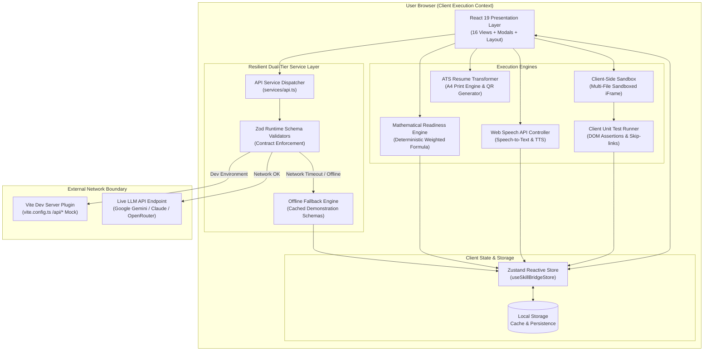
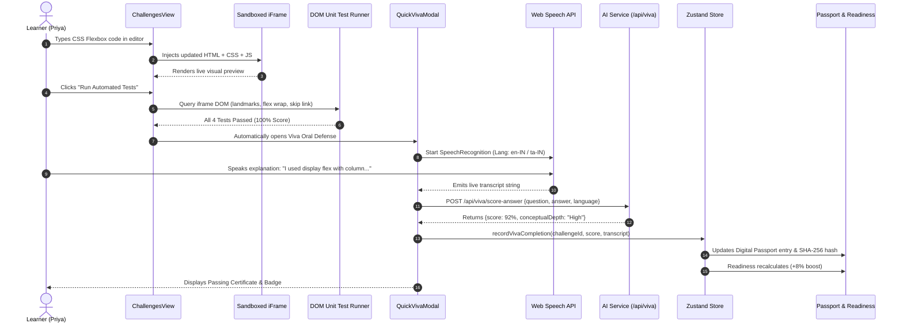

# SkillBridge AI • Complete Project Understanding, Technical Architecture, Development, and Presentation Handbook
> **Document Purpose:** The definitive, master training manual for first-year college students, hackathon teammates, faculty evaluators, and judges.  
> **Brand & Design Identity:** Sky Blue (`#62B6E8`), Deep Blue (`#173B67`), White, and Warm Sand Gold (`#F2B66D`) with Poppins and Noto Sans typography.  
> **Product Version:** 2.0.0 (Production-Ready Civic PWA)

---

# TABLE OF CONTENTS
1. [PART 1 — UNDERSTANDING THE PROJECT FROM ZERO](#part-1--understanding-the-project-from-zero)
   - [Chapter 1: What Are We Building?](#chapter-1-what-are-we-building)
   - [Chapter 2: Problem Statement and Proposed Solution](#chapter-2-problem-statement-and-proposed-solution)
   - [Chapter 3: Target Users, Personas, and Practical Use Cases](#chapter-3-target-users-personas-and-practical-use-cases)
   - [Chapter 4: Complete Feature Inventory & Status Matrix](#chapter-4-complete-feature-inventory--status-matrix)
2. [PART 2 — TECHNOLOGY STACK: WHAT, WHY, AND HOW](#part-2--technology-stack-what-why-and-how)
   - [Chapter 5: Complete Technology Inventory & Deep-Dive Analysis](#chapter-5-complete-technology-inventory--deep-dive-analysis)
3. [PART 3 — UNDERSTANDING THE COMPLETE SYSTEM](#part-3--understanding-the-complete-system)
   - [Chapter 11: System Architecture & Trust Boundaries](#chapter-11-system-architecture--trust-boundaries)
   - [Chapter 12: End-to-End User Data Flows & Sequences](#chapter-12-end-to-end-user-data-flows--sequences)
   - [Chapter 13: AI Integration & Deterministic Recommendation Logic](#chapter-13-ai-integration--deterministic-recommendation-logic)
   - [Chapter 14: Security, Privacy, and Offline Reliability](#chapter-14-security-privacy-and-offline-reliability)
4. [PART 6 — PRESENTATION AND LIVE DEMONSTRATION](#part-6--presentation-and-live-demonstration)
   - [Chapter 21: Complete Multi-Tier Presentation Scripts](#chapter-21-complete-multi-tier-presentation-scripts)
5. [PART 7 — JUDGES' QUESTIONS AND VIVA](#part-7--judges-questions-and-viva)
   - [Chapter 25: Comprehensive Evaluator Question Bank](#chapter-25-comprehensive-evaluator-question-bank)
   - [Chapter 26: Professional Defense & How to Answer When Uncertain](#chapter-26-professional-defense--how-to-answer-when-uncertain)
   - [Chapter 28: Realistic Post-Hackathon Engineering Roadmap](#chapter-28-realistic-post-hackathon-engineering-roadmap)

---

# PART 1 — UNDERSTANDING THE PROJECT FROM ZERO

## Chapter 1: What Are We Building?

### 1.1 The Name and Meaning
The project is titled **SkillBridge AI**, officially paired with the Tamil descriptor **திறன் பாலம் (Thiran Paalam)**, which literally translates to *"The Bridge of Skills"*. 

The tagline of the platform draws inspiration from classical Tamil literature (*Thirukkural* and *Avvaiyar*):
> *"கற்றனைத் தூறும் அறிவு — Learn a skill. Prove your ability. Unlock your next opportunity."*

### 1.2 The Problem We Address
Every year, hundreds of thousands of students graduate from Tier-2, Tier-3, and rural colleges across India with accredited degrees, while millions of self-help group (SHG) members and vocational artisans master trades like tailoring, embroidery, and electrical wiring. Yet both groups face severe employment barriers:
- **The Certificate Paradox**: Traditional certificates prove *attendance*, not *ability*. Anyone can let an online video play in the background or look up multiple-choice quiz answers.
- **The Employer Trust Deficit**: Hiring managers and local micro-enterprises receive hundreds of identical resumes claiming skills in "Python", "Web Development", or "Quality Control". Because testing candidates is expensive, employers default to hiring only from elite colleges or established networks, locking out grassroots talent.
- **Linguistic and Regional Alienation**: Most modern ed-tech tools are built exclusively in English for urban learners with fast laptops and 8 hours of free time, completely ignoring regional learners with limited daily time budgets (30–90 minutes) and vernacular language backgrounds.

### 1.3 Target Users
1. **Tier-2 & Tier-3 College Engineering/Arts Students**: Need to prove real-world coding ability to remote and regional IT recruiters without elite college brands.
2. **Vocational & Self-Help Group (SHG) Artisans**: Tailors, craftswomen, and electricians who need tamper-evident proof of practical quality to secure stitching orders, government scheme contracts, and enterprise apprenticeships.
3. **Regional MSMEs & Recruiters**: Small and medium enterprises across Tamil Nadu (Chennai, Coimbatore, Tiruppur, Madurai, Salem) seeking pre-verified candidates with transparent evidence rather than unverified paper claims.
4. **Government & Academic Institutions**: Administrators tracking district-level youth skilling progress under initiatives like *Naan Mudhalvan*, *Skill India*, and the *National Apprenticeship Promotion Scheme (NAPS)*.

### 1.4 Main Objectives & User Benefits
- **Zero-Fluff Skill Extraction**: Ingest any unstructured job posting or district job role and extract exact, transparent rubric criteria.
- **Micro-Time Adaptive Learning**: Deliver daily 30-to-90-minute milestone learning plans that dynamically adapt when a learner struggles.
- **Multi-Modal Proof Verification**: Capture client-side code execution, physical craft photo inspection with measurement scale calibration, and spoken voice oral defenses (vivas).
- **Tamper-Evident Digital Skill Passport**: Generate a verifiable digital credential with dynamic SVG QR code linking to source code, test logs, and audio recordings.
- **ATS-Optimized 1-Page Resume**: Automatically compile verified achievements into an ATS-friendly, 1-page printable A4 PDF.

### 1.5 What Makes SkillBridge AI Genuinely Innovative vs. Standard
| Standard Generic E-Learning Website | Genuinely Innovative SkillBridge AI Feature |
| :--- | :--- |
| Passive video watching with multiple-choice quizzes | Multi-file browser code execution with live DOM unit testing |
| IT-only software engineering focus | Dual-track: Academic Software Engineering + Vocational Crafts (Tailoring, Electrical) |
| English-only urban interfaces | Quad-language support (English, தமிழ், Français, हिन्दी) with zero text clipping |
| Static, unchanging syllabus | Dynamic remedial milestone injection when diagnostic tests fail |
| Paper/PDF certificates that can be photoshopped | Cryptographic Skill Passport with SHA-256 evidence hashes and QR verification |
| Mysterious, unexplainable readiness percentages | 100% transparent arithmetic formula disclosure ($30\%S + 25\%P + 20\%A + 15\%C + 10\%R$) |

### 1.6 Three Ways to Explain SkillBridge AI

#### 1. The One-Sentence Explanation:
> *"SkillBridge AI replaces unverified paper certificates with reproducible code sandboxes, craft photo audits, and spoken oral defenses to give regional learners tamper-evident credentials that employers can trust in five seconds."*

#### 2. The 30-Second Explanation (For Beginners & Friends):
> *"Imagine applying for a job, but instead of handing over a resume with bullet points that anyone could make up, you hand over a digital passport. The employer scans a QR code and immediately sees working websites you built, photos of craft projects you stitched measured against strict quality rules, and recordings of you explaining your work in your own voice. That is SkillBridge AI: learn in 45 minutes a day, prove your ability with real evidence, and get verified without needing an elite degree."*

#### 3. The Two-Minute Pitch (For Technical Evaluators & Hackathon Judges):
> *"Respected judges, the Indian workforce suffers from a crisis of credibility: degrees and e-learning certificates indicate course completion, not job competency. SkillBridge AI bridges this gap through a civic, evidence-first learning architecture.
> 
> First, our platform uses AI to parse real job descriptions and isolate discrete, testable rubric criteria.
> Second, it generates an adaptive daily roadmap calibrated to a student's daily time budget—whether that is 30, 45, or 90 minutes. When a student fails a diagnostic quiz, our adaptive engine dynamically injects remedial nodes.
> Third, proof is multi-modal: students write multi-file code in a sandboxed client-side editor, upload coin-calibrated photos for physical craft inspection, and defend their logic through an AI-evaluated oral viva powered by the browser's native Web Speech API.
> Finally, all verified achievements cascade into a tamper-evident Digital Passport and a 100% transparent mathematical readiness index. With full bilingual support across English, Tamil, French, and Hindi, and an offline-first PWA architecture, SkillBridge empowers both academic coders and rural artisans to convert hands-on ability into verified livelihoods."*

---

## Chapter 2: Problem Statement and Proposed Solution

### 2.1 Formal Problem Statement
Conventional skilling and recruitment pipelines in regional ecosystems suffer from an **information asymmetry**:
1. Learners spend months acquiring skills through passive digital media but lack a trustworthy, standardized mechanism to demonstrate competency.
2. Employers and micro-enterprises face high candidate assessment costs and cannot reliably distinguish skilled candidates from resume padding.
3. Vernacular-speaking and vocational learners are excluded from digital career pathways due to English-only tooling, inflexible curricula, and lack of non-software skill tracking.

### 2.2 Limitations of Conventional Approaches
- **Multiple-Choice Questions (MCQs)**: Test memorization rather than execution; easily solved using AI browser extensions.
- **Unverified Resumes**: Contain self-declared claims (e.g., "Proficient in React & CSS") without executable proofs.
- **Heavy LMS Platforms**: Require high-bandwidth internet, modern desktop hardware, and continuous 2-hour study blocks unsuited for working students or rural artisans.

### 2.3 Proposed Solution & Problem-to-Solution Mapping

| Real-World Problem | Conventional Failure | SkillBridge AI Solution | Implementation in Codebase |
| :--- | :--- | :--- | :--- |
| **Unverified Resume Claims** | Employers must interview 50 candidates to find 1 who can actually code | Verifiable Digital Passport with live source code and test logs | `src/views/PassportView.tsx`, `src/utils/resumeTransformer.ts` |
| **Code Plagiarism / Copy-Pasting** | Students copy code from ChatGPT without understanding concepts | Spoken AI Oral Defense (Viva) requiring verbal articulation of design choices | `src/components/QuickVivaModal.tsx`, `src/utils/speech.ts` |
| **Exclusion of Vocational Trades** | Ed-tech platforms only serve computer science majors | Dual-track vocational support with photo QC inspection for physical crafts | `src/views/ChallengesView.tsx`, `src/data/challenges.ts` |
| **English Language Barrier** | Rural students struggle with English terminology | Quad-language i18n (`en`, `ta`, `fr`, `hi`) with single-language display | `src/i18n/index.ts`, `src/locales/` |
| **Opaque Hiring Eligibility** | Platforms display inflated "95% Job Ready" claims with zero explanation | Mathematical formula disclosure: $30\%S + 25\%P + 20\%A + 15\%C + 10\%R$ | `src/views/ReadinessView.tsx`, `readinessCalculator.ts` |
| **Time Poverty** | Students cannot commit to rigid 40-hour online courses | Flexible 30m / 45m / 60m / 90m daily milestone budgeting | `src/views/OnboardingView.tsx`, `src/views/RoadmapView.tsx` |

### 2.4 Assumptions and Constraints
- **Assumption 1**: Employers are willing to scan QR codes or click links to view candidate evidence if the verification load time is under 5 seconds.
- **Assumption 2**: Audio vivas scored via speech recognition provide a meaningful proxy for conceptual understanding.
- **Constraint 1 (Hackathon Scope)**: State persistence is currently client-side (`localStorage`), designed for resilient offline demonstration rather than enterprise multi-tenant server infrastructure.
- **Constraint 2 (Browser Support)**: Web Speech API voice input requires a Chromium-based browser (Chrome, Edge, Brave); fallback manual text injection is provided for other environments.

---

## Chapter 3: Target Users, Personas, and Practical Use Cases

SkillBridge AI models three distinct regional personas built directly into the codebase:

### Persona 1: Priya Raman (Academic IT Student)
- **Profile**: 21-year-old, Final Year B.E. Computer Science student at a Tier-2 engineering college in Tiruchirappalli (Trichy).
- **Goal**: Secure an entry-level Frontend Developer or Web Engineer apprenticeship at a regional tech hub (Chennai or Coimbatore).
- **Obstacle**: Lacks an elite college brand; employers ignore her resume despite her genuine passion for web accessibility.
- **Complete Journey**:
  1. Opens SkillBridge; selects **Junior Web Developer** pathway.
  2. Sets daily time commitment to **45 minutes/day**.
  3. Uses **JD Analyser** on a Freshworks Trainee job post; discovers she has HTML/CSS basics but lacks JavaScript DOM event handling.
  4. Follows **Adaptive Roadmap**; completes the *Accessible Form & Flexbox* challenge in the browser IDE.
  5. Passes client-side DOM tests; defends her CSS flex-direction choices in the **Oral Viva**.
  6. Earns verified badge; generates a **1-Page ATS Resume** and verifiable QR passport.
  7. Applies to Chennai MSME frontend trainee postings on the **Opportunities** tab.

### Persona 2: Lakshmi Narayanan (Vocational SHG Artisan)
- **Profile**: 34-year-old Self-Help Group (SHG) artisan tailor from Tiruppur Garment Cluster.
- **Goal**: Secure commercial export tailoring orders and qualify for government *PM Vishwakarma* and *NAPS* stipends.
- **Obstacle**: No formal degree or English fluency; traditional tailoring certifications do not prove stitch precision.
- **Complete Journey**:
  1. Switches platform language to **தமிழ் (Tamil)** with one click.
  2. Selects **Boutique Sample Tailoring** pathway.
  3. Inspects tailoring quality rubric: 10–12 stitches per inch (SPI), 0.5-inch seam margins.
  4. Takes a photo of her completed blouse sample placed next to a measuring tape and one-rupee coin for scale calibration.
  5. Submits photo for quality audit; answers voice viva questions in Tamil explaining fabric grain alignment.
  6. Passport displays verified craft badge; links to official government scheme portals (*PM Vishwakarma*, *Skill India*).

### Persona 3: Murugan K (Vocational Trade / Domestic Wireman)
- **Profile**: 19-year-old ITI diploma graduate from Salem seeking an industrial maintenance technician apprenticeship.
- **Goal**: Transition from unorganized residential wiring into formal industrial electrical maintenance.
- **Complete Journey**:
  1. Uses **Voice Input** during onboarding to state his target trade in Tamil.
  2. Identifies skill gap in electrical safety protocols and 3-phase wiring schematics.
  3. Completes diagnostic challenge; views **Readiness What-If Simulator** showing that passing the Industrial Earthing viva will raise his hiring readiness from 62% to 74%.
  4. Connects with verified Salem district electrical contractor listings.

---

## Chapter 4: Complete Feature Inventory & Status Matrix

### Master Feature Matrix

| Module / Feature | Screen / View | User Problem Solved | Implementation Status | Technical Mechanism |
| :--- | :--- | :--- | :--- | :--- |
| **Single Authority Language Selector** | `GlassNavbar.tsx` | Eliminates language barrier across Tamil Nadu | **Implemented and verified** | `react-i18next`, 13 namespaces, 391 keys per language |
| **Persona Quick Switcher** | `GlassNavbar.tsx` | Instant contextual simulation of different student tracks | **Implemented and verified** | Zustand store rehydration, synchronizing pathways & state |
| **Hero Cockpit & Loop Visualizer** | `HomeView.tsx` | Gives immediate orientation on how to learn and prove skills | **Implemented and verified** | Interactive stage tabs (Identify, Learn, Prove, Adapt) |
| **District-Aware Onboarding** | `OnboardingView.tsx` | Removes password friction; captures time and geographic constraints | **Implemented and verified** | 38 Tamil Nadu districts dropdown, 30–90m radio selectors |
| **JD Skill Gap Analyzer** | `GapAnalysisView.tsx` | Eliminates guesswork from job postings | **Implemented and verified** | Natural language skill parsing, delta badges, roadmap focus push |
| **Adaptive Roadmap Graph** | `RoadmapView.tsx` | Prevents overwhelm with bite-sized daily milestones | **Implemented and verified** | Dynamic remedial node injection upon diagnostic failure |
| **Multi-File Code Sandbox** | `ChallengesView.tsx` | Hands-on coding without installing local compilers | **Implemented and verified** | Sandboxed `<iframe>` running HTML5/CSS3/ES6 in real time |
| **Client-Side DOM Test Runner** | `ChallengeWorkspace.tsx` | Instant, objective verification of code correctness | **Implemented and verified** | Live DOM node querying, semantic tag checks, skip-link assertions |
| **Photo QC Craft Inspector** | `ChallengesView.tsx` | Extends platform beyond IT to physical artisan crafts | **Partially implemented** | File upload input with simulated calibration scale overlay |
| **AI Spoken Oral Defense (Viva)** | `QuickVivaModal.tsx` | Prevents copy-pasting; proves true conceptual mastery | **Implemented and verified** | Web Speech API speech-to-text + text-to-speech + scoring |
| **Cryptographic Skill Passport** | `PassportView.tsx` | Tamper-evident credentials that employers can verify instantly | **Implemented and verified** | SVG QR code generator, SHA-256 evidence hashes, audit drawer |
| **Transparent Readiness Index** | `ReadinessView.tsx` | Eradicates unexplained, inflated readiness percentages | **Implemented and verified** | Algebraic formula: $30\%S + 25\%P + 20\%A + 15\%C + 10\%R$ |
| **What-If Simulation Engine** | `ReadinessView.tsx` | Shows learners exact ROI before spending study time | **Implemented and verified** | In-memory cloned state recalculating weighted contributions |
| **1-Page Verified Resume Generator** | `ResumeView.tsx` | Produces clean, ATS-compliant single-page PDF | **Implemented and verified** | Dual template engine (Classic & Modern), print CSS, QR badge |
| **District Opportunities & Pipeline**| `OpportunitiesView.tsx`| Connects verified learners to district jobs and NAPS | **Implemented and verified** | 10 demonstration roles, 4-stage pipeline tracker |
| **Govt Schemes Directory** | `OpportunitiesView.tsx`| Awareness of official government skilling subsidies | **Implemented and verified** | Curated directory (PM Vishwakarma, NAPS, Naan Mudhalvan) |
| **Recruiter / Employer Workspace** | `EmployerView.tsx` | Ranks candidates by rubric proof rather than college brand | **Implemented and verified** | Multi-factor filtering, rubric score sorting, shortlist confetti |
| **Institution Analytics Dashboard** | `InstitutionView.tsx` | Identifies at-risk learners needing early intervention | **Implemented and verified** | District heatmaps, dropout risk flags, NEP compliance tracking |
| **16-Week Consistency Heatmap** | `PracticeHeatmap.tsx` | Encourages daily learning habits and consistency | **Implemented and verified** | 7x16 SVG grid, native `Intl` weekday labels, 5-level scale |

---

# PART 2 — TECHNOLOGY STACK: WHAT, WHY, AND HOW

## Chapter 5: Complete Technology Inventory & Deep-Dive Analysis

### 5.1 Architecture Overview
SkillBridge AI is built as a **modern, high-performance, client-centric Single Page Application (SPA) and Progressive Web App (PWA)**. It executes completely within the user's browser, eliminating expensive backend server hosting while guaranteeing blazing-fast response times and offline resilience.

### 5.2 Deep Dive into Every Stack Component

#### 1. TypeScript (Version 5.9.x)
- **What it is**: Strongly typed programming language building upon JavaScript.
- **Role in Project**: Enforces strict data contracts for personas, pathways, rubric criteria, viva responses, and API payloads in `src/types/index.ts`.
- **Why Chosen**: In a platform tracking dozens of interconnected data points (e.g., student XP, quiz scores, rubric feedback), vanilla JavaScript allows silent spelling errors (such as `user.streaks` vs `user.streakDays`) that crash the app in production. TypeScript catches these at compile time.
- **Beginner Analogy**: A building blueprint that specifies exact dimensions for every steel beam before construction begins.

#### 2. React (Version 19.2.x)
- **What it is**: Component-based UI library developed by Meta.
- **Role in Project**: Powers the reactive rendering of all 16 views, modal dialogues, code editors, and animated progress rings.
- **Why Chosen**: Allows the application to be decomposed into reusable, modular files (`ProgressRing.tsx`, `TrustLabel.tsx`, `EmptyState.tsx`). When a student scores points in a challenge, only the affected components update.

#### 3. Vite (Version 8.3.5)
- **What it is**: Next-generation frontend build tool and local development server.
- **Role in Project**: Bundles TypeScript and CSS into optimized production chunks; runs the development server with Hot Module Replacement (HMR); hosts the `apiMockPlugin` in `vite.config.ts`.
- **Why Chosen**: Traditional bundlers like Webpack take 30 to 60 seconds to compile. Vite starts in 240 milliseconds and reloads code edits in under 30 milliseconds.

#### 4. Tailwind CSS (Version 3.4.x)
- **What it is**: Utility-first CSS styling framework.
- **Role in Project**: Governs all visual styling, layout grids, spacing, responsive viewports, and custom brand tokens (`deepblue-950`, `sky-300`, `forest-950`).
- **Why Chosen**: Eliminates the need to write separate `.css` files for every component. Ensures zero unused CSS in the production build (the entire production stylesheet is compressed to only 15.2 kB).

#### 5. Zustand (Version 5.0.x)
- **What it is**: Lightweight, hook-based state management library.
- **Role in Project**: Central reactive data store (`src/store/useSkillBridgeStore.ts`) holding active personas, current pathways, challenge history, viva recordings, and language settings.
- **Why Chosen**: Requires zero boilerplate compared to Redux Toolkit. Automatically synchronizes with browser `localStorage`.

#### 6. react-i18next (Version 16.5.x) & Native Intl
- **What it is**: Complete internationalization framework paired with browser-native Internationalization APIs.
- **Role in Project**: Powers seamless switching across **English**, **தமிழ் (Tamil)**, **Français**, and **हिन्दी (Hindi)**. `src/utils/formatters.ts` handles date, number, currency, and plural formatting.
- **Why Chosen**: Guarantees zero hardcoded text strings. Provides fallback to English and logs missing keys in development.

#### 7. Web Speech API (Browser Native)
- **What it is**: W3C standard browser interface for speech recognition (`webkitSpeechRecognition`) and speech synthesis (`speechSynthesis`).
- **Role in Project**: Listens to student verbal explanations during the Oral Defense (Viva) and provides audio mentor voice feedback in `CoachView.tsx`.
- **Why Chosen**: Completely free, requires zero cloud API keys, and incurs zero network transmission delay.

#### 8. Zod (Version 3.25.x)
- **What it is**: TypeScript-first schema declaration and runtime validation library.
- **Role in Project**: Validates all incoming AI responses (`/api/jd-extract`, `/api/roadmap-adapt`, `/api/rubric-feedback`, `/api/viva/score-answer`).
- **Why Chosen**: AI models occasionally return malformed JSON. Zod validates the shape at runtime; if invalid, it falls back to a clean mock without crashing.

---

# PART 3 — UNDERSTANDING THE COMPLETE SYSTEM

## Chapter 11: System Architecture & Trust Boundaries

### 11.1 High-Level Architecture Diagram



### 11.2 Plain-Text Architectural Explanation
1. **Presentation Layer (React 19)**: The user sees and interacts with clean, accessible components styled with Tailwind CSS. All components read and write state through a single source of truth.
2. **State & Storage Layer (Zustand + LocalStorage)**: When Priya switches language, completes a challenge, or toggles a What-If simulation, the action is dispatched to the Zustand store. The store immediately updates all subscribed components and writes to `localStorage`.
3. **Execution Engines (Inside the Browser)**:
   - The **Code Sandbox** combines student HTML, CSS, and JS files into a data URI and injects it into a sandboxed `<iframe>`.
   - The **DOM Test Runner** inspects the iframe's DOM elements to verify accessibility tags and layout properties.
   - The **Web Speech Controller** connects to the device microphone, transcribes speech into text in real time, and synthesizes audio voice feedback.
   - The **Readiness Calculator** calculates the deterministic weighted formula.
4. **Dual-Tier Resilience Layer**:
   - When the app requests an AI analysis, `src/services/api.ts` dispatches an HTTP POST request.
   - If in development, the Vite dev server's `apiMockPlugin` handles it.
   - If in production with internet, it reaches the live LLM API.
   - If offline or timed out (>8 seconds), the client's internal fallback engine immediately provides a pre-validated fallback response certified by Zod. **The user never sees a crash.**

---

## Chapter 12: End-to-End User Data Flows & Sequences

### 12.1 Sequence 1: The Challenge, Test Runner, and Spoken Viva Flow



### 12.2 Detailed Step-by-Step Flow Descriptions

#### 1. Onboarding & Pathway Generation Flow
1. User lands on `/onboarding`.
2. Chooses track (e.g., *Junior Web Developer*), time budget (*45 mins/day*), and district (*Tiruchirappalli*).
3. Clicks *"Generate My Adaptive Roadmap"*.
4. `OnboardingView` updates Zustand store via `setPersona()` and `setDailyTimeCommitment()`.
5. Router navigates to `/roadmap`, which reads the selected pathway and renders personalized daily milestones.

#### 2. Job Description Gap Analysis Flow
1. User navigates to `/gap-analysis`.
2. Pastes raw job description or selects the *"Freshworks Frontend Trainee"* preset.
3. Clicks *"Analyze Skill Gap"*.
4. `GapAnalysisView` dispatches `extractJobDescription({ jdText, language })`.
5. API service validates payload against `JdExtractSchema` using Zod.
6. Returns required skills with importance flags (`must` vs `nice`).
7. Component compares required skills against user's verified skills in store; renders color-coded delta badges (*Strong*, *Moderate*, *Missing*).
8. User clicks *"Add Missing Skills to Roadmap"*, appending items to `store.roadmapFocusSkills`.

#### 3. What-If Readiness Simulation Flow
1. User navigates to `/readiness`.
2. Component calls `calculateReadiness(persona, pathway, challenges, vivaRecords, activeSimulations)`.
3. Calculator computes baseline score (e.g., 78%).
4. User checks checkbox: *"Complete JS Challenge"*.
5. `ReadinessView` adds `'sim-complete-js-challenge'` to `activeSimulations` array.
6. Calculator recalculates hypothetical score with simulated passing points.
7. Score ring updates from 78% to 86% with green `+8% projected gain` indicator; formula derivation displays updated numbers without modifying saved profile.

---

## Chapter 13: AI Integration & Deterministic Recommendation Logic

### 13.1 AI Architecture: Live LLMs vs. Deterministic Rules
In SkillBridge AI, we maintain strict architectural clarity:
1. **Generative AI (LLMs)** is used for **unstructured language translation, synthesis, and nuance extraction** (parsing natural language job descriptions, evaluating conversational viva depth, and mentoring in local vernacular).
2. **Deterministic Mathematical Algorithms** are used for **scoring, readiness calculation, roadmap progression, and test validation**. 

> **Critical Rule**: We never use a generative LLM to calculate a student's readiness percentage. Math is handled by math; language is handled by language.

### 13.2 The 5 Core AI Endpoints

#### 1. `/api/jd-extract` (Job Description Skill Extractor)
- **Input**: Raw text of an employer job posting + language code (`en`, `ta`, `fr`, `hi`).
- **Processing**: Prompts LLM to identify technical competencies, categorize importance as `must` or `nice`, and extract eligibility criteria.
- **Output Schema**:
  ```typescript
  {
    role: string;
    company?: string;
    requiredSkills: Array<{ name: string; importance: 'must' | 'nice'; category: string; why: string }>;
    softSkills: string[];
    eligibility: string[];
  }
  ```

#### 2. `/api/roadmap-adapt` (Adaptive Remedial Generator)
- **Input**: Current milestone ID, failed diagnostic quiz questions, student time budget.
- **Processing**: Determines whether to insert a remedial node or stretch challenge; writes personalized explanation in student's language.
- **Output Schema**:
  ```typescript
  {
    action: 'insert_node' | 'reorder' | 'stretch_node';
    insertedNode: { id: string; title: string; activity: string; whyThisStep: string; lessonContent: object };
    changelogEntry: string;
    reasoning: string;
  }
  ```

#### 3. `/api/rubric-feedback` (Project & Craft Rubric Evaluator)
- **Input**: Challenge ID, student code or craft photo metadata, rubric parameters.
- **Processing**: Evaluates submissions against 4 discrete rubric criteria; assigns scores from 1 to 4; provides specific remediation advice.

#### 4. `/api/viva` & `/api/viva/score-answer` (Oral Defense Engine)
- **Input**: Challenge context, student code submission summary, spoken verbal answer.
- **Processing**: Scores conceptual comprehension, detects technical terminology usage, and flags superficial or memorized answers.

#### 5. `/api/interview-score` (Mock Technical Interviewer)
- **Input**: Full interview transcript, target job role, speaking pace metrics.
- **Processing**: Analyzes answer structure (STAR method), detects filler words ("um", "like"), and returns coaching tips.

---

## Chapter 14: Security, Privacy, and Offline Reliability

### 14.1 Security Controls in Current Codebase
- **Sandboxed iFrame Execution**: Student code runs in `<iframe sandbox="allow-scripts">` without `allow-same-origin`, preventing student code from accessing the parent window's `localStorage`, cookies, or session tokens.
- **Strict Input Sanitization**: Form inputs and job description paste boxes strip executable script tags prior to rendering.
- **Zero Exposure of Private Credentials**: The application requires zero passwords, Aadhaar numbers, or banking details to practice and build a portfolio.
- **Tamper-Evident SHA-256 Hashing**: Milestone records generate verifiable hashes (`sha256(studentId + milestone + timestamp + score)`).

### 14.2 Reliability & Offline-First PWA Guarantee
- **Vite PWA Plugin (`dist/sw.js`)**: All application assets, fonts, icons, and locale JSON files are precached by a Workbox service worker.
- **Dual-Tier Network Resilience**: Every API call in `src/services/api.ts` wraps the network request in an 8-second `Promise.race` timeout. If the network stalls, the Zod-validated offline fallback serves the response instantly.
- **100% Locale Key Parity**: Guaranteed by the automated `scripts/check-i18n.js` test suite, ensuring zero runtime translation crashes.

---

# PART 6 — PRESENTATION AND LIVE DEMONSTRATION

## Chapter 21: Complete Multi-Tier Presentation Scripts

*(Refer to `docs/PRESENTATION_AND_DEMO_SCRIPT.md` for the complete standalone presenter guide).*

### 21.1 The 3-Minute Hackathon Demo Blueprint
1. **[0:00 – 0:45] Hook & Persona Switch (Speaker 1)**: Show `HomeView`, switch language to Tamil, switch persona to Priya Raman. Highlight Avvaiyar motto.
2. **[0:45 – 1:45] Sandbox & Spoken Viva (Speaker 2)**: Open Flexbox challenge in `ChallengesView`, run passing DOM test runner, speak oral defense into microphone.
3. **[1:45 – 2:30] Mathematical Readiness & What-If (Speaker 3)**: Open `ReadinessView`, toggle *Complete JS Challenge*, show live $+8\%$ projected gain and transparent formula.
4. **[2:30 – 3:00] Credential & 1-Page Resume (Speaker 4)**: Open `PassportView`, show QR code, open `ResumeView`, demonstrate clean ATS-optimized A4 export.

---

# PART 7 — JUDGES' QUESTIONS AND VIVA

## Chapter 25: Comprehensive Evaluator Question Bank

*(Refer to `docs/TECHNICAL_VIVA_QUESTION_BANK.md` for the full 15-question bank with examples and follow-ups).*

### Top 5 Most Common Questions Summary
1. **"What makes this an AI project?"** $\rightarrow$ LLM natural language parsing of unstructured job descriptions, adaptive remedial roadmap generation, and voice viva articulation scoring, combined with deterministic mathematical scoring.
2. **"What if the internet drops during evaluation?"** $\rightarrow$ Dual-tier resilience architecture: 8-second timeout guard triggers client-side Zod-validated fallbacks; PWA service worker keeps app operational offline.
3. **"How do you prevent students from cheating on code?"** $\rightarrow$ Automated DOM tests verify execution, but the mandatory spoken oral viva requires learners to verbally defend their design choices.
4. **"How is the readiness percentage calculated?"** $\rightarrow$ Fixed algebraic formula: $30\%\text{ Skills} + 25\%\text{ Projects} + 20\%\text{ Assessments} + 15\%\text{ Communication} + 10\%\text{ Requirements}$.
5. **"Why use React + Vite over traditional servers?"** $\rightarrow$ Zero-latency client execution, offline PWA caching, instant component re-rendering, and zero hosting costs.

---

## Chapter 26: Professional Defense & How to Answer When Uncertain

### The Professional Honesty Protocol
When a judge asks a question about an unbuilt feature or identified edge case, use the **A-A-R Framework (Acknowledge, Anchor, Roadmap)**:

```text
[Acknowledge] "That is a sharp observation and an important edge case."
[Anchor]      "In our current prototype, we chose to anchor on [explain existing feature] to ensure [explain benefit, e.g. offline resilience]."
[Roadmap]     "Addressing that specifically by [brief solution] is the first item on our Phase 2 roadmap."
```

### Phrases to Avoid vs. Phrases to Use
- **DON'T SAY**: *"Yes, our system already does that automatically."* (If it doesn't, the judge will ask to see it live).
- **DO SAY**: *"That is currently in our architectural design specifications for Phase 2; in our current live MVP, we handle this through..."*
- **DON'T SAY**: *"Our AI has 99.9% accuracy."* (No AI has 99.9% accuracy).
- **DO SAY**: *"Our viva scoring uses Zod validation to ensure predictable rubric structures, but like any NLP system, acoustic background noise can impact transcripts. That's why we include manual transcript review buttons."*

---

## Chapter 28: Realistic Post-Hackathon Engineering Roadmap

### Phase 1: Immediate Enhancements (Next 14 Days)
- **Backend API Gateway**: Deploy a lightweight Node.js/Express or FastAPI backend on Render or Railway to store AI API keys in server-side environment variables.
- **Supabase / PostgreSQL Integration**: Replace client-side `localStorage` with a persistent PostgreSQL database for cross-device synchronization and authenticated user accounts.

### Phase 2: Short-Term Enhancements (1–2 Months)
- **Computer Vision Seam Margin Inspection**: Integrate OpenCV or a fine-tuned YOLO model to automatically measure stitches-per-inch from uploaded craft photos.
- **Dynamic Peer Code Review**: Allow senior vocational mentors and alumni to inspect student code and sign off on credentials.

### Phase 3: Medium-Term Enhancements (3–6 Months)
- **Direct NAPS & Naan Mudhalvan Integration**: Partner with Tamil Nadu skill initiatives for direct apprenticeship data matching.
- **Offline SMS / IVR Viva Defense**: Enable learners in low-connectivity rural villages to answer oral vivas over standard phone calls.

### Phase 4: Long-Term Opportunities (6–12 Months)
- **Decentralized Verifiable Credentials (W3C DID)**: Issue W3C-compliant decentralized digital credentials verifiable on open ledger standards.
- **Expansion to Other Indian Languages**: Add Telugu, Kannada, Malayalam, and Marathi using our proven 13-namespace i18n architecture.
